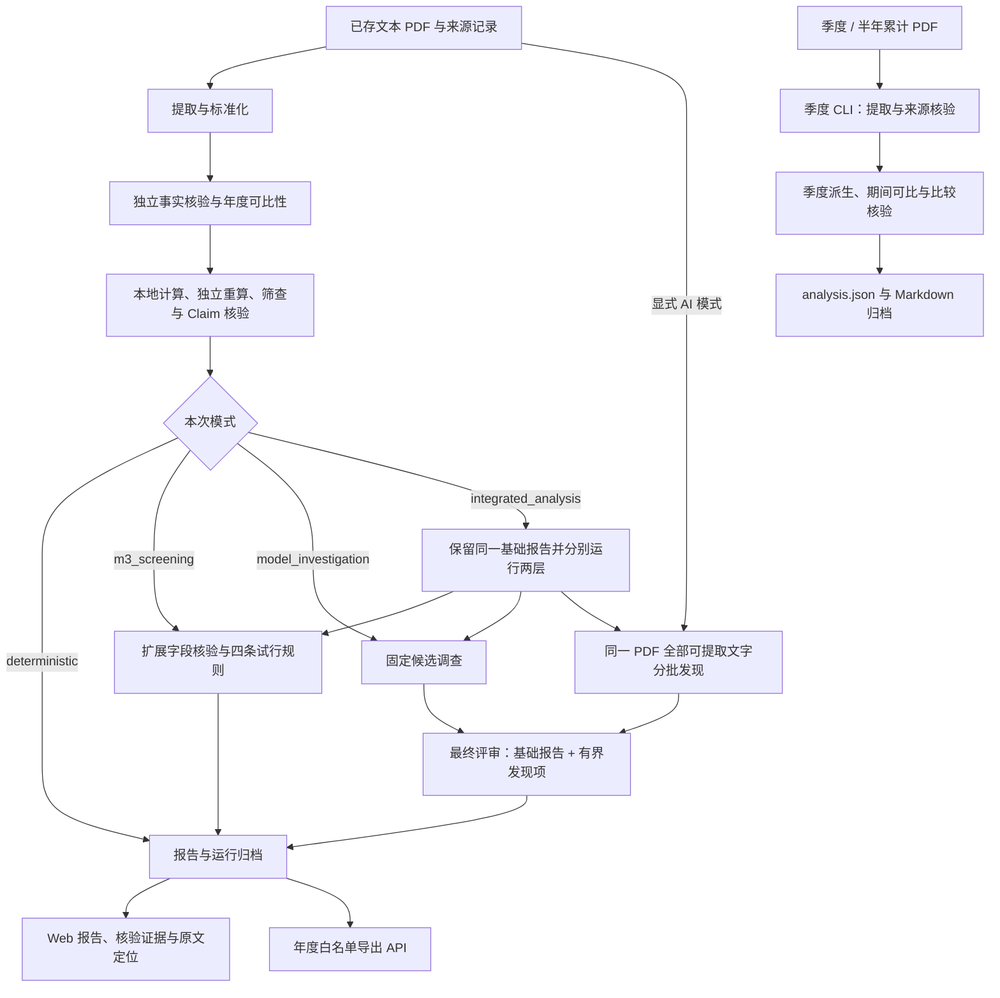

# 架构与模块边界

本文描述当前模块与行为契约，不保存逐次测试流水。能力摘要、启动与配置见 [README](../README.md)，实现里程碑见 [roadmap.md](roadmap.md)，既往结果见 [验收记录](verification-history.md)。活动年度执行/预算/恢复合同以本文[专节](#annual-execution-budget)为准；R6 首次真实失败与语义限制见[R6 验收](verification-history.md#annual-analysis-recovery-r6)，落地已观测检查见[落地验收](verification-history.md#annual-analysis-recovery-r6-landing)。年度是主要 Web/API 分析路径；季度目前是独立 CLI 切片，不复用或改写年度事实契约。

## 1. 系统与流程

React + TypeScript + Vite 负责本机展示，Python + FastAPI 负责处理与核验。LangGraph 是第一版唯一的智能体编排框架；模型通过后端 Chat Completions 连接器调用，本地 Python 使用 Decimal 计算。项目不内置默认供应方或型号，不含账户系统。

开发工具配置位于 [.omp/](../.omp/)，用于 OMP 主控及子代理的开发协作，不由 frontend/backend 加载，也不改变应用内部 LangGraph 的编排契约。协作规则见 [AGENTS.md](../AGENTS.md)，使用与交接步骤见[开发说明](development.md)。

四种模式为 deterministic、m3_screening、model_investigation 与 integrated_analysis。两个 AI 模式均包含固定候选调查、独立原 PDF 全文发现和最终评审；发现按原文顺序规划全部可提取文字，不依赖固定候选、已核验指标或 M3。LangGraph 是唯一智能体编排层。标准 Web/CLI 活动外层与发现信封为 v10，内层业务绑定仍为 v4 / plan_v3 / discovery_v3 解析器，提示词为 annual_discovery_v4；最多三个在途请求，引用检查和检查点发布由单协调者执行。事项算法、review_v3 与 wire/projection 不变。全部合格发现形成完整事项成员账，有界归并及同源补证后进入评审；尺寸或预算不足保留全量候选及未完成状态，不读取任意新来源。旧 review_v2 按原有界输入重建。integrated_analysis 另行归档独立 M3，不进入 AI 输入。附加层失败或缺口不抹去基础报告及其他成功层；硬中断不保证最终报告，严格读取器可读取正式部分快照。deterministic 与独立 M3 不调用模型。版本、调度和覆盖见[年度执行合同](#annual-execution-budget)与[全文发现契约](annual-discovery.md)。

年度归档读取支持 JSON、Markdown 与离线 HTML 白名单导出：先校验归档 manifest、报告身份和来源 PDF SHA，再输出受控字段；不导出整份 PDF、整页图、原始模型请求/响应或密钥。新全文发现层不导出自己的 `raw_text` 和 `quote`；既有叙述层仍有受控原文片段投影。PDF 由用户在浏览器打印离线 HTML 产生，服务端没有 PDF 导出端点。导出具体边界见[年度报告下载](annual-report-export.md)。

导出的年度可比性要求其 document_id、source_sha256 与 report_year 完整匹配当前归档；缺少任一来源绑定时结果标为“来源未验证”，任一字段错配则标为“来源错配”，两种情况下都不输出可比性证据。M3、模型调查与最终评审层也校验来源身份；身份缺失或不匹配时只保留受限状态，不投影规则明细或模型意见。归档中若声明顶层 `model_review`，该顶层字段的缺失/错配处理优先于调查层里嵌套的历史评审，避免通过嵌套副本绕过来源检查。该契约的专项与浏览器接受状态见[验收记录](verification-history.md)。

季度是 `scripts/analyze_quarterly.py` 启动的独立本地流程，输入清单限定在 `data/`，只覆盖营业收入、归母净利润和经营活动现金流量净额。每个累计来源事实、派生单季结果、期间可比性和同比/环比结果分层核验，归档到唯一 `quarterly-analysis-<UUID>` 的 JSON 与 Markdown；当前不提供季度 Web 任务 API。公式、proof 和未知可比性的处理见[季度分析切片](quarterly-analysis.md)。

旧年度预检是独立兼容流程：旧事实、旧同比、引用坐标金额与单位换算复核、可选 screening。上传与创建预检分步，不能把旧预检复核描述为 v2 独立事实核验。类型风险见 [历史字段审计](current-schema-audit.md)。

## 2. 模块职责

后端模块位于 `backend/src/finagent/`。

| 模块 | 职责与边界 |
| --- | --- |
| api | 上传、任务队列、设置、能力状态、归档读取、证据页图与年度导出；编排现有 CLI，不堆放财务公式 |
| ingestion | 读取文本型 PDF，定位指标、期间、单位/币种、口径与证据；不执行 OCR |
| schemas | 旧 FinancialFact、隔离的 v2 事实、TableCellEvidence、计算、核验、Claim 及季度 observation/derived/comparison/proof 类型 |
| verification | 独立重读原文、检查行列与字段、年度及季度可比性、重算、支持依据；缺证据时弃权 |
| finance | Decimal 公式、年度差额/增长率、季度累计差分与期间比较、确定性候选与 M3 试行规则 |
| retrieval | `annual_context.py` 为固定候选调查检索同源 MD&A/财务附注片段；`annual_discovery_context.py` 规划本次 PDF 所有非空提取文字，逐块切片并按来源 SHA、页码和块内位置绑定 ID，不做章节/主题关键词过滤。`annual_issue_supplements.py` 为事项补证扫描同源提取块并选择有界正文窗口，命中和模型角色不构成独立核验。叙述 `reading_context` 是 API 对已核验引用构造的页面展示补全，不属于全文发现规划 |
| agents | 固定候选调查与独立全文发现使用 LangGraph；年度流程另调用事项归并/补证和最终结构化评审函数，未引入第二套智能体框架；`annual_issue_pipeline.py` 管完整成员账、局部分片与跨片闭合，`annual_review.py` 独立保留旧 review_v2 与新 review_v3。`annual_review_wire.py` 对事项完整输入使用 `annual_issue_input_compact_v1` 无损编码，对评审用途投影使用 `annual_model_review_v3_compact_v4` 无损编码及严格还原；投影边界见第5节。模型观点不升级为独立核验 |
| tools | 将已有业务能力适配为工具，不复制解析、计算或核验实现 |
| llm | 同步 Chat Completions 纯文本接口；实际 HTTP 在本连接器创建的可终止子进程中执行，父进程控制墙钟截止、取消和有限重试；请求限共有字段 |
| audit | 模型请求与结果的脱敏调用记录、时间及状态；记录失败不能伪装为审计成功 |
| reports | 组装 JSON/Markdown、读取归档并按年度白名单投影 JSON/Markdown/HTML；来源错误或新发现层校验失败时 fail closed；保留失败/缺口、来源与可选模型层 |
| quarterly | `ingestion/quarterly.py`、`finance/quarterly.py`、`verification/quarterly.py` 与 `reports/quarterly_analysis.py` 承载季度层，不改变年度 FinancialFactV2 |
| core | 公共路径、配置与异常；`annual_checkpoints` 管不可变快照、原子指针和最终封存，`annual_recovery` 管恢复绑定及能力，`annual_work_budget` 管版本固定默认合同和 live 阶段分配，`model_call_ledger` 管跨进程原子请求准入、计数与关闭门控 |

前端 `pages` 组织年度分析、设置和旧预检；`components` 承载公共组件及 `AnnualReportOverview` 重点概览；`api` 处理请求及错误；`types` 定义读取类型；`styles` 管展示。财务计算和模型调用不在浏览器执行。普通入口以显式 AI 复选框及高级 M3 选项映射既有四 mode，不改变后端请求或历史模式。报告按“标题与状态 → 重点概览 → 基础财务对照 → 完整线索与处理账”阅读；概览选择和来源限制见[全文发现页面契约](annual-discovery.md#页面旧归档与任务阶段)。比较输入诊断把可比性身份/期间绑定失败与可比性证据不足分开说明，不改变资格判定或事实核验本身。

新建入口与历史列表采用可键盘操作的原生折叠。显式选择报告后收起导航并聚焦报告标题；报告轮询不反复聚焦，不收起用户已打开的入口，也不打断正在输入的新任务。补跑和重新全量分析使用被选中归档/任务的原来源与完整模式，不读取新建表单当前选项；重新读取只走 GET。旧预检作为独立旧流程保留。

## 3. HTTP 与任务契约

浏览器通过 Vite 的 `/api` 代理访问下列后端路由：

| 路由 | 行为 |
| --- | --- |
| POST /v1/text-pdf-uploads | multipart PDF、company_id、report_year；上限 32 MiB；新建 raw/processed 文件，不覆盖旧输入，不自动开始分析 |
| POST /v1/annual-prechecks | 创建旧预检 |
| GET /v1/annual-prechecks/{run_id} | 读取旧预检归档 |
| POST /v1/annual-analysis-jobs | 以已存来源创建 deterministic / m3_screening / model_investigation / integrated_analysis 任务 |
| GET /v1/annual-analysis-jobs/{job_id} | 查询阶段、状态、结果 run_id / result_url；运行中的年度 CLI 阶段可附带来源绑定的安全批次进度，发现层分别统计 successful/partial/failed |
| POST /v1/annual-analysis-jobs/{job_id}/cancel | 幂等取消排队或活动任务；先关闭请求准入，再收束本服务实际拥有的 CLI，保留可信部分报告；已封存最终报告不降级 |
| POST /v1/annual-analysis-jobs/{job_id}/resume | 仅接受 `parent_run_id`，严格校验父报告与当前恢复绑定，按原请求创建一个新的子任务；同一父运行只允许一个活动子任务 |
| GET /v1/annual-analysis-history?limit=20&offset=0 | 只读本机年度任务与报告索引，按创建时间分页并报告总条数 |
| GET /v1/annual-analyses/{run_id} | 严格读取已归档最终报告或已发布部分快照，返回快照状态、序号、父运行关系，并分开返回已核验、narrative 与全文发现来源索引 |
| GET /v1/annual-analyses/{run_id}/export?format=json\|markdown\|html | 验证既有年度归档及来源绑定后按白名单导出；不重跑分析、不导出整份 PDF/整页图、密钥或原始模型请求/响应 |
| GET /v1/annual-analyses/{run_id}/evidence/{evidence_id}/preview.png | 已核验证据白名单页图 |
| GET /v1/annual-analyses/{run_id}/narrative-evidences | 读取归档且被模型解释引用的年报原文片段索引 |
| GET /v1/annual-analyses/{run_id}/narrative-evidences/{evidence_id}/preview.png | 预览上述原文片段的 PDF 页图 |
| GET /v1/annual-analyses/{run_id}/discovery-evidences | 读取被全文发现引用的原文片段索引 |
| GET /v1/annual-analyses/{run_id}/discovery-evidences/{evidence_id}/preview.png | 预览已校验引用所在 PDF 页图 |
| GET /v1/annual-analyses/{run_id}/issue-evidences | 读取同源补证片段及其未核验角色；常规报告不返回该层原文 |
| GET /v1/annual-analyses/{run_id}/issue-evidences/{evidence_id}/preview.png | 在严格来源白名单内预览补证所在 PDF 页图，支持 focus |
| GET /v1/annual-analysis-capabilities | 返回模型模式就绪状态；`model_investigation.annual_discovery_supported` 标记当前后端是否包含全文发现接入 |
| GET /v1/runtime-identity | 返回启动时捕获的 API/CLI 协议与加载代码指纹、当前磁盘源码指纹及活跃任务数；不读取模型配置、不调用模型 |
| GET / PUT / DELETE /v1/model-settings | 读取非密钥状态、保存完整本机配置、清除配置 |
| POST /v1/model-settings/test | 按草稿真实测试连接，不保存草稿、不发送年报 |

任务校验 `source_pdf_path` 相对 data/raw 的范围、符号链接、公司/年度/文档目录、source.json 身份及 SHA256；同时接收 company_id、report_year、document_id、sha256、mode。上传请求中的公司/年度不等于已从 PDF 独立确认的身份。

有界队列为单进程最多一个运行任务、三个排队任务。job.json 写入 `artifacts/annual-analysis-jobs/<job_id>/`；状态为 queued、running、completed、completed_with_issues、failed、interrupted、cancelled。模型配置或 LangGraph 未就绪时创建模型任务返回 503。执行时预分配 run_id，排队取消不启动 CLI。服务重启先关闭遗留任务的准入并写取消标记，再有界确认旧 CLI 停止；仅观察本服务保存的 PID 与创建身份或读取精确停止确认，不按裸 PID 终止进程。确认前允许可信部分读取，续跑能力为 `parent_active`；确认后保存中断状态，已封存最终报告及已有失败事实保留。

API 在应用创建时捕获实际加载函数代码、对应源码清单与协议身份，同时用只读 CLI 探针记录启动身份。诊断分别返回不可变的启动快照和当前磁盘指纹。创建任务和开始执行时核对两者及当前 CLI；Web CLI 必须携带预期指纹，并在读取来源或模型设置前验证。前端提交前也要求该协议，旧 API 缺少端点时拒绝提交。启动脚本仅在监听 PID、项目命令行和无活跃任务均确认时重启本项目旧 API；未知进程或无法确认的状态拒绝处理。

ASGI 启动入口为 `finagent.api.app:create_app --factory`。仅导入 API 模块不构造项目服务、不触发遗留任务恢复；服务在显式调用应用工厂时建立。Windows 开发启动、手动命令和受控运行均使用工厂；便携入口已显式调用 `create_app(project_root=ROOT)`，保持该行为。真实归档测试先复制指定运行/报告与提示词到隔离项目，不对开发工作区初始化服务。

job 的 GET 可附带 `result_availability` 只读投影，状态为 available/unavailable，含安全类别、报告 URL 和快照状态、序号、是否部分结果及父 run_id。available 要求严格年度读取器通过，并与原请求公司、报告期、文档和 SHA 一致；只读查询不把历史失败改成成功。结构不兼容与来源校验失败分别表达，恢复读取不触发 CLI 或模型调用。`recovery_capability` 给出能否续跑及安全原因；`recovery_progress` 分开报告本次、父链与累计的全部模型阶段准入，扫描层只计自身批次，两者均不代表整个 goal 的共同额度。

新 AI job 的 `analysis_budget`（`annual_analysis_budget_v4`）给出该 job 实际运行时限、工作/发布余量、阶段尝试上限及当前准入、剩余额度、排队与运行时间。运行从实际 running 起点开始计时；终态 elapsed 冻结为实际耗时，不能裁到预算上限。API 将绝对单调时钟软/硬截止、阶段时限和原子 gate 传给 CLI，CLI 核对完整契约。历史 job 的 v1/v2/v3 投影按各自固定政策校验，不套用活动默认。归档执行层的 `phase_budget` 是版本固定默认合同，不代表本次 API owner 的实际有效值；三轴版本、归档默认与 owner 实际、CLI 截止及单次上限见[年度执行合同](#annual-execution-budget)。

CLI 先发布正式基础快照；显式 AI 流程在首个模型请求前建立完整恢复绑定与待处理计划，先做全文发现，再做固定候选调查、事项归并及同源补证，最后执行新评审。基础、逐批与阶段结果使用 `artifacts/reports/<run_id>/checkpoints/` 下的不可变快照及运行目录中的 `checkpoint-current.json` 原子指针；最终封存后禁止追加。发布中断时，只读取通过来源和结构检查的已发布快照，未封存结果仍是部分结果。恢复绑定包含源 SHA、原完整 mode、模型与供应方指纹、提示词、解析器、计划及稳定 M3 语义输入；旧归档缺少绑定时只能只读，不能推定可续跑。子任务复用成功批次和独立完成的调查，失败批次重试返回空或再失败时仍保留父运行合格发现；父记录不回写。

固定调查结论续跑时，只有父归档中每个引用 ID 均存在且关联相同 signal 的解释才可复用；缺失证据的历史解释重新调查，不伪造引用。父叙述证据先经严格读取器对本次 PDF 原文与坐标复核，再随复用结论进入 LangGraph 初始上下文。保留父引用优先，新增检索复用原有 8 段/4000 字符总预算，不裁掉已继承引用；全部候选已复用时不重复检索或调用模型。检查点、最终报告、评审输入与预览使用同一完整引用池，父归档不回写。

任务终态结算承认严格读取器已接受的旧终态归档：`snapshot` 为 None 时沿用 manifest 的 `completed` / `completed_with_issues`。现行流程缺少最终快照封存仍拒绝把任务标为完成。取消、所属写入者确认和准入门关闭保护不变。

正式报告、检查点指针和 manifest 的原子替换仅对 Windows 指定占用错误做有界重试。报告或最终指针持续发布失败时写失败记录与 failed manifest，保留最后可信部分快照；最终 seal 已发布后，若终态 manifest 替换失败，则保留旧 manifest 和 sealed 指针，CLI 退出失败但不损坏已封存结果的严格读取窗口。模型阶段完成不能替代最终耐久发布确认。

检查点序号分配与指针发布使用有界跨进程文件锁。锁文件不保存业务数据，按普通文件类型及设备/文件 ID 确认同一对象，不把另一写入者初始化导致的长度/mtime 变化误判为文件替换。Windows/POSIX 均可锁定 EOF 之后的区间，无需并发截长初始化；原文、manifest、快照与指针的完整内容身份校验不因此放宽。

正常完成及早期失败也由 API owner 关闭该 job 的准入门后才公布终态；共享账本中的其他 job 不受影响。关门失败时保留可信报告只读，job 暂为 interrupted，错误为 `call_gate_unavailable`，续跑待关门与所属写入者退出确认；后续收束可保留已经封存的最终报告。取消、超时和执行异常收尾先关闭准入，再确认所属 CLI 停止，才追加终态快照；无法确认时保留可信报告只读并暂缓续跑。心跳更新通过普通文件身份检查和 Windows 文件句柄或 POSIX 文件描述符完成，失败会停止后续准入。已封存报告不被取消收尾降级。

已完成评审仅在完整投影前业务输入与恢复绑定一致时复用，使用明确原因 `review_reused_for_matching_inputs`，本次响应与尝试均为零。子运行保留原成功审计索引；严格读取沿有界父链检查原请求、逐次准入、耐久响应及解析结果，不凭复用标记放行。旧评审输入不含核验时间；当前评审用途投影省略 Claim 核验时间，完整本地记录仍保留。复用签名仅对显式 Claim 核验池中的有效 ISO 时间作归一化，区分有效时间存在、字段缺失及非 ISO 值，并保留无效或 null 原值。事实、发现、调查解释、覆盖或缺口变化会使复用失效，不能因模型投影省略字段而忽略完整业务变动。对应实测与阶段状态仍以恢复任务书及验收记录为准。

模型连接器在每次实际联网前持久化准入，自动重试分别计数；耐久响应、合格发现及复用批次分别记录。普通任务使用隔离 gate，启用 `FINTRACE_MODEL_CALL_LEDGER_CONFIG` 时所有调用入口共用指定账本及已核对来源策略。策略的 `limit` 为正整数时施加共享累计上限，为显式 JSON `null` 时只取消该总上限，仍完整计账；SQLite `provider_policy.quota_limit=0` 表达无限额，不是零次准入。已有有限策略不会因配置改成 null 自动放行，须依据新增授权显式更新原策略行，保留全部历史尝试。任务/阶段尝试预算、有限截止、取消、来源及供应方绑定不因此取消。共同账本仅首次显式初始化；已使用账本缺失、损坏或表结构不全时拒绝外发，不修复成零计数。策略文件、进程确认与计账不含密钥。发现覆盖契约见[全文发现说明](annual-discovery.md)，活动执行/预算/恢复合同见[下文](#annual-execution-budget)，阶段验收状态见[恢复任务书](annual-analysis-recovery-plan.md)。

**年度执行、预算与恢复合同**

预算第二档及两家真实运行保留 v7 历史身份；v8 更新发现提示词及来源引文优先补证，仍有覆盖、归并/评审及语义缺口。v9 根据完整真实请求体积另立容量合同；活动 v10 继承该容量和时间政策，只另立更小局部归并分片身份。不截断输入，不增加时间、尝试预算或并发。软件与受控运行、各历史真实结果及新版在线关卡分别记账，不据软件验证推定金融语义通过，见[落地验收](verification-history.md#annual-analysis-recovery-r6-landing)。

**三轴版本。** 活动外层年度绑定为 `fintrace_annual_execution_binding_v10` / `execution_v10`，发现信封为 `fintrace_annual_discovery_execution_v10`。内层业务绑定仍为 `fintrace_annual_discovery_execution_v4` / `annual_discovery_plan_v3`，使用 `annual_discovery_v4` 提示词和 discovery_v3 解析器；事项算法仍为 pipeline_v1 / review_v3 及既有 wire/projection。v10 继承 `supplement_retrieval_version=source_anchor_then_ngram_v2`、提示词原始字节身份及全局/补证和评审容量绑定，新增 `grouping_shard_plan_version=member_bounded_v2` 与严格整数 `grouping_shard_max_members=3`。新执行与合法续跑只接受 v10 exact；旧 v5/v6/v7/v8/v9 归档只读，不跨外层、提示词、归并分片计划、补证版本或预算政策复用。

**活动预算与只读预算。** 活动投影为 `annual_analysis_budget_v4`：整份硬截止 375 秒、工作软截止 360 秒、收尾 15 秒；阶段上限为扫描 150 秒、固定调查 60 秒、归并/补证 90 秒、最终评审 45 秒。完整全局归并/补证 Chat Completions 请求上限 96000 字符，完整评审请求上限 128000 字符；调用方 override 不得放大，不截原文或完整成员。字符数不是 token 数，应用容量不证明供应方上下文接受能力。年度单次 HTTP/worker 上限仍为 90.0 秒，并被共享阶段截止与工作截止 clamp；归并阶段不为各子调用重置公共时间。已保存模型配置的 60 秒不改写。默认尝试次数不变：首次 30（扫描/固定调查/归并补证/评审 18/2/8/2）、续跑 20（14/2/2/2）；扫描并发默认 3。`archived_budget_contract_v4(*, scope)` 固定 v9/v10 共用归档政策，`public_budget_contract` 活动投影使用 v4。历史 v7/v8 的 v3 冻结为 375/360/15 秒、阶段 150/60/90/45 秒、评审 body 40000/cap 90；历史 v6/v2 冻结为 345/330/15 秒、阶段 150/60/60/45 秒、body 40000/cap 60；历史 v5/v1 冻结为 300/285/15 秒、阶段 150/60/35/25 秒、body 24000。严格读取及评审输入/审计按归档自身政策重构，不以活动常量改旧合同。

**共享累计策略显示。** 新 v4 job 在接受和实际 running 时分别通过只读账本快照保存共同上限及当时余额：有限策略显示实际正整数与余额，无共享累计上限显示 null。只读快照不准入、不初始化或修复账本，缺失/损坏的已用账本及配置与持久策略不匹配时拒绝创建或执行。旧 job 的 null 仅表示当时未记录，不追溯解释成无限；归档 `phase_budget` 的 null 也是未记录实际共享策略，页面明确区别于本次任务预算。共享策略本身及累计计账规则见[上文](#3-http-与任务契约)。

**归档默认与 owner 实际。** 归档 `phase_budget` 是版本固定默认合同，不是本次 API owner 实际时限；JSON `phase_budget_basis=version_default_not_owner_actual`，Markdown/HTML 同义说明。来源、业务输入、模型、提示词、计划和政策均相同时，owner 从 60 秒改为 375 秒可以复用；实际 owner 时间不参与归档身份，不得写成 archive default。v6 的 60→345、v7 的 60→375 受控动态证明各自保留历史版本范围，不替代当前活动合同或真实语义验收；当前证据见[落地验收](verification-history.md#annual-analysis-recovery-r6-landing)。

**CLI 截止与单次上限。** API owner/watchdog 使用 375 秒硬截止并传递 360 秒软截止；解析与核验消耗同一整份时间，排队另记，不在 AI 开始后重置。有限 deadline 与五类环境覆盖采用 all-or-none，owner 范围 60–375 秒、硬软间隔严格 15 秒，并拒绝远未来截止。活动阶段按整数 largest-remainder 适配 owner 工作时间；历史 v2/v1 runtime 分配使用各自冻结权重。独立 CLI 从入口创建同一软工作预算，调用受阶段和软截止限制，但没有 API 父进程 hard-kill。未绑定恢复的独立发现调用也使用新提示词和紧凑 plan_v3 / discovery_v3 解析器；自定义目录调用不因此获得正式续跑身份。

Web 模型任务（model_investigation 与 integrated_analysis）按 README 的本机文件优先/环境回退规则注入配置；deterministic 与独立 M3 子进程移除 MODEL_*。集成模式的 M3 计算不使用模型配置；固定候选调查、全文发现与最终评审均属于显式 AI 流程。Web job 超时、阶段分配、单次上限与恢复政策见[年度执行合同](#annual-execution-budget)。CLI 仍只读环境。设置读取 API 不回显密钥并禁止缓存；设置路由检查 loopback Host，修改与测试还检查本机 Origin。这些是设置路由的约束，不代表所有 API 有相同防护。应用不全局强制 host，按启动命令绑定 127.0.0.1。

`GET /v1/annual-analysis-history` 的 `limit` 默认 20、允许 1–50；`offset` 默认 0、须为非负整数。HTTP 查询值越界或无法解析返回 422。响应顶层为 `{items, total, limit, offset}`；每项主要包含 `item_id`、公司代码/年报年份/类型、来源文档编号和文件名、总状态、独立的 `job_status` 与 `run_status`、任务 `mode` 与归档 `run_mode`、`created_at`、`job_id`/`run_id`、`replay`、`result_available` 和 `{code, message}` 形式的 `issues`。缺失或无效的创建时间排在有效时间之后；有效时间按新到旧排序，同时间以条目标识稳定排序。

索引同时收集持久化 job 与成功的 CLI run。job 和其 run 只有在公司、报告年度、来源文档编号及 PDF SHA256 完全相同时才关联为一个条目；校验不符时不误关联，CLI 归档仍可单独列出。任务状态与运行状态分别展示，模式冲突会记入 issues。本机历史页数和条数取决于当时合法归档；`total` 是该次索引读取发现的合格归档总数，不是固定额度。

扫描限制和路径保护：job JSON 最大 512 KiB、run manifest 最大 2 MiB、report JSON 最大 32 MiB；通常对来源 `source.pdf` 只做安全路径/文件类型与文件大小元数据检查（上限 256 MiB）。failed/interrupted job 的恢复可用性另经严格年度读取器校验，包括原 PDF SHA 和引用；每次索引请求内部复用同一 run 的校验结果。归档 JSON 读取要求其路径位于项目根目录内、拒绝符号链接/Windows reparse point，并在打开前后复核文件身份；缺损或不安全的单项不会拖垮整张索引。

对于成功 job 或独立 CLI run，`result_available=true` 表示关联归档状态为 `completed` 或 `completed_with_issues`、所需文件可安全读取，且 report JSON 的 run/company/year/document/source SHA 与 manifest 对得上；这条索引路径不重核 PDF 正文。对于 failed/interrupted job，还要求严格读取通过；issues 明示原失败事实与恢复可读性。两者都不表示 AI 语义或金融判断经过独立复核，也不保证文件之后变化时 GET 仍成功。索引不读取 `source.json`、模型设置或调用审计响应，job 与 run 状态分别展示。

上传失败且无可提取文字时返回 422，只撤回该次新建文件。原始文件名、绝对路径或密钥不得进入处理说明。旧资料与归档不可回写。

## 4. 财务与证据契约

解析保留文档标识、原始 SHA256、PDF 的 1-based 物理页序号、文字块和未旋转坐标；坐标原点左上，单位为 PDF point。旋转后 page.rect 的宽高不能直接套用未旋转块坐标。无文字页明确为空，不猜 OCR 结果；加密/损坏 PDF 报错。

v2 事实核验重新打开原 PDF，检查金额、年度列、期间角色、币种、单位与报表口径；不能把提取器自带坐标或重复使用同一提取值当作独立证据。事实状态为 verified、conflict、insufficient_evidence。财务事实字段与来源要求详见 [数据规则](data-policy.md)。候选提取支持同一 `PdfTextBlock` 内的多行精确标签与两年金额；独立核验重读 PDF 字词，核对换行百分比表头及按横坐标分离的比较列。不从利润行派生现金或资产金额。公司代码或页码不是通用放行条件；版式不满足时弃权。

年度计算需要可比性依据；unknown 不默认可比。当前海天 proof 基于同一 2024 年报第 116、163、197 页，未与单独披露的 2023 年报独立勾稽。proof 绑定来源与期间，由当前进程签发；序列化副本仅供审计，不能在后续进程重建授权。可比性区分摘要/情况说明与重要会计政策等正文标题：即使勾选不适用或没有复选框，仍读取正文。有限的无条件“无影响”句式可以确认无影响；明确存在的比较期影响导致 conflict，无法判定的比较期影响导致 insufficient_evidence，不把两者混为一类。期初未分配利润调整金额空白不得当作零；无法按年度列解释的非零合计会阻断确认。若两个输入均通过核验且可比性成立，才计算差额；在此基础上，比较基数非正时保留差额并对增长率弃权。若可比性不足或任一输入未核验通过，则差额与增长率都弃权。

M3 使用应收账款净额、存货净额、合并净利润、营业成本、扣非归母净利润等扩展事实。四条试行规则为：

| 规则 | 触发条件 |
| --- | --- |
| 利润与现金流 | 合并净利润 > 0，经营现金流净额 < 0 |
| 扣非影响 | 归母净利润 > 0，abs(归母净利润 − 扣非归母净利润) / 归母净利润 ≥ 30% |
| 应收偏离 | 应收账款净额增速 − 营业收入增速 ≥ 20 个百分点 |
| 存货偏离 | 存货净额增速 − 营业成本增速 ≥ 20 个百分点 |

每条触发计 25 分；任一规则不可计算，总分为 None，不把部分结果按完整总分展示。阈值未经隔离评测校准，分数不是风险概率或舞弊结论。Markdown 计算值最多显示六位小数，JSON 保留 Decimal 原值，规则在舍入前判断。

年度报告 API 中每条规则的 `issues` 是结构化原因数组，正式归档项为 `{code, message}`，`code` 与 `message` 均为字符串；前端保留未知但类型有效的 code，并显示原始 message。客户端兼容字符串项，将其规范化为 `{code: null, message}`；结构化项的 code/message 缺失、为 null 或类型错误，以及 null、数组、数字等非法项均拒绝整份响应。弃权状态仍保留 `total_score: null`，不按零分补齐。

输入必须唯一、同公司同源、单位/币种/期间角色及口径相容，逐条独立核验；提取与核验 evidence ID 不重叠。筛查接收同一进程 verify_financial_fact 的直接结果。VerificationResult 本身不是签名 proof，手工重建对象或反序列化 JSON 不能用来证明已核验。

扣非归母净利润来自“主要会计数据”，保持 statement_type=key_financial_data、scope=unknown，排除同比百分比栏。规则二语义映射要求：同源 PDF 存在唯一“主要会计数据”标题、明确人民币单位，扣非事实与合并利润表归母净利润均有唯一独立 verified 结果，再从该表重读“归属于上市公司股东的净利润”并与利润表两年值精确对值。本进程对 source+IDs+values 签发 HMAC proof；JSON 副本、手工对象或其他公司/页码捷径不能授权。定位必须发现实际页、年份、币种、单位和直接归母行。non_recurring_total 是披露合计，不是扣非归母净利润；其显式单位副本只供审计，不输入规则。映射成功只证明跨表对值成立，不等于财务语义真人正确率；当前对照与弃权边界见[R6 验收](verification-history.md#annual-analysis-recovery-r6)。

Claim 类型为 fact、calculation、inference、hypothesis；同比属于 calculation。确定性 Claim 检查只覆盖已实现类型与支持依据，不泛化为模型自由文本语义核验。原文出处和引用 ID 存在，也不证明因果关系。

## 5. 模型、报告与展示

固定候选调查保持受限同源检索与单次补充检索，不开放任意互联网或评测标签。独立全文发现分批发送原 PDF 全部可提取文字，不以候选、指标或 M3 作为触发条件；发现观点均未核验。review_v3 接收基础报告、全部合格发现事项/候选、成员去向、原引用、补证角色及完整缺口，不按 priority 截前十二条。活动 v10 与旧 v9/v8/v7/v6/v5 的请求上限按自身归档政策重构，不能容纳则保留全量和未评审原因；旧 review_v2 有界输入及 16000 字符上限不变。见[年度执行合同](#annual-execution-budget)与[全文发现契约](annual-discovery.md)。

新评审由同一请求 helper 执行 `annual_review_v3_purpose_projection_v1`、typed 编码与官方 Chat body 序列化，预算、实际调用、审计和严格读取共用它。完整基础报告、核验记录及定位留在本地；投影仅省略 `claim_evidence_pool[*]` 的列明抽取/坐标机械字段及其五类 region 的 bbox，空值的 printed_page/legacy_text_region/surrounding_text，以及 comparability.evidence、narrative_evidences、investigation_items.citations、issue_hierarchy.candidate_pool.citations、issue_hierarchy.supplement_pool 中的 bbox 和 claim_verification_pool.record.verified_at。非空原文、表头/行列/单位文本、来源标识、SHA、PDF 页、数值口径、检查/冲突/限制、完整成员及范围账保留；白名单外同名字段不递归删除。核验池内部指针可同步替换为无碰撞短别名，输出允许的业务 ID 保持原值。

评审外层 `annual_model_review_v3_compact_v4` 精确含 schema_version/key_pool/string_pool/object_pool/data，使用非布尔整数节点标记、完整对象/列表包装、列向量和精确重复列表；解码还原投影对象，不恢复已省略元数据，禁止子串替换、私用区、压缩或截断。事项外层 `annual_issue_input_compact_v1` 保持完整语义输入及独立字符串节点协议。v10 继承 review_wire_version、review_input_projection_version、提示词字节哈希和补证版本绑定；评审审计保存完整语义、投影及请求正文哈希。缺失或未知身份拒绝读取/复用；旧 v9/v8/v7/v6/v5/v3/v4 与 review_v2 按自身政策读取，不套活动身份。

当前流程加载 `annual_investigation_v1.md`、`annual_discovery_v4.md`、`annual_issue_grouping_v1.md`、`annual_issue_global_v1.md`、`annual_issue_supplement_v1.md` 与 `annual_review_v3.md`。新发现提示词要求纳入已披露原因，区分主体、报告期、资产/负债方向和比较基准；允许一条发现分别引用多个相关片段，不拼接 quote。紧凑输入仍使用批内短别名与共享来源头，discovery_v3 解析器每批最多三条，别名还原后执行原引用检查；旧提示词文件和 v1/v2 解析规则只用于各自历史身份。v2 六条上限不能套用到 v3；不跨版本续跑。逐 finding 部分接受不放宽字段、数字、断言或精确引用；仅唯一 Unicode 空白差异可恢复为同片段内连续原文，并计入 restored_quotes。输入文本是不可信数据；提示词遵守、引用绑定及最终评审均不是独立语义核验。评审观点仍拒绝阿拉伯数字且只引用输入 ID。完整规则见[全文发现契约](annual-discovery.md)。

发现解析保留原模型观点文字，仅在确定性断言检查的副本上识别局部疑问：紧邻“是否”、可选紧邻“确认”的完整禁止断言片段不视为确认结论，且作为局部边界，不让其中的“不/没有”豁免后面的独立断言。确认或排除舞弊仍拒绝；字段之间不共享疑问或否定范围。合法疑问不降低数字、来源、别名或精确引用要求，也不补写旧失败批次为成功。

新 `model_issue_pipeline` 使用 `annual_issue_pipeline_v1`。每个合格 finding 保留完整观察、关注理由、核查动作、引文和定位；成员处理账逐项表达保留、合并、排除或待处理。仅完整业务描述及引用等价的明确重复可本地合并，共用引文不能证明同一事项。语义分片须完整回答本片成员，多个分片再处理全部已知事项的跨片关系。排除须引用该成员的原证据和精确原文；非法、遗漏、预算或尺寸不足均保留待处理账。已知事项关系闭合与发现文字覆盖分别表达，局部完成不能推断全文无重点。

活动 `member_bounded_v2` 按原始 finding 成员数分片，每片至多 3 人，完整请求仍受 22000 字符上限；超过三人的精确重复组确定性拆分，每个子组的代表必须属于其成员。旧 v9 及更早计划按历史最多 12 人重建。每次局部 checkpoint 同步当前 provisional issues、排除成员和全局待处理账，局部接纳不等于全局闭合。任务或调用额度耗尽停止新准入并保存 partial 与全部 pending；鉴权、账本配置或审计故障不因此改成成功。更小分片可能需要多次合法续跑，不能按初始或续跑阶段额度保证一轮完成全部局部、全局和补证。

活动补证使用 `source_anchor_then_ngram_v2`：先从验证过的引文位置提取原文指标、主体和数值锚点，再处理同块、相邻说明及同源注释；模型措辞仅作后续 ngram 回退。远端具体附注优先于重复报表数字；同处非指标锚与同页编号表题用于区分相关金额附注和仅共享主体的其他科目，通用计提/减值措辞不充当主体锚。摘录是原块连续区间，围绕实际引文位置而非一律截块首；不拼接原文，不承诺检出全部解释。未知章节保持 unknown，选片原因区分来源锚点、相邻上下文和关键词回退，不把几何相邻伪写成关键词匹配。上限不变：40 检索词、每事项 4 片、每片 500 字符、32 角色任务。旧 `section_filter_then_ngram_overlap_v1` 及归档语义冻结。retrieval_coverage 区分扫描、命中、选片、未选配对及角色完成；selected_excerpt_chars 为摘录总量，selected_unique_source_chars 为同块区间并集，omitted_chars 不是发现层遗漏。补证 ID 绑定来源 SHA、页块起点，严格读取重核终点、原文及坐标。发现引文固定 primary_finding_quote；补证角色仅 context、possible_explanation 或 unknown，全部未核验，不补记核验通过。

补证重建仅在一次检索调用内复用 block 的紧凑文本与非空期间/主体集合，以及每个 issue 的来源参照集合；不跨请求缓存，不改变选片、评分、顺序、原文区间、ID 或覆盖账。空集合不持续分配到每个 block。额外峰值内存和性能验证范围见[落地验收](verification-history.md#annual-analysis-recovery-r6-landing)，不据两份原件的观测承诺任意压缩 PDF 的最大内存表现。

合法 `role_status=pending` 的补证可在原报告中缺省 issue_roles，而受控原文索引将其规范为空数组；前端仅兼容这一缺省与空数组的对应关系。索引和抽屉仍须通过同源/同 SHA、报告快照哈希、页块字符范围、坐标、数量顺序及预览路由检查，明确角色尚待标注。accepted 状态须有有效非空逐问题角色并精确匹配，不能将缺省或空角色伪造为已完成标注。

活动 v10 保存精确内层发现绑定、提示词字节身份、归并分片计划、补证算法版本及事项/评审契约；发现检查点也须具有匹配的事项待处理绑定，缺失或伪造身份拒绝。归并、跨片关系、补证角色及评审只在业务输入、来源、配置、政策和原成功审计均匹配时零请求复用；父归档不改写。常规 API 与三格式导出使用按版本列明字段的最小 execution_binding 展示投影，v10 另展示两个分片计划字段，不暴露原恢复绑定或供应方指纹；严格归档读取、审计和续跑仍使用完整绑定。事项投影移除原文，保留引用 ID、位置、成员路径、角色、缺口及计数；原文由受控索引和页图读取。presentation_order 是独立显示投影，依据已完成评审引用、定位、动作及成员账稳定排序，不按 raw priority，不回写评审输入。

一次任务状态 GET 在释放服务锁后严格读取一次报告，结果或本次失败用于全部状态投影，避免重复重建 PDF、父恢复链和审计。失败不能升级为可读或可续跑；下一次 GET 重新核验，不使用跨请求缓存，也不延长 HTTP 观察时限。

严格读取中的 `SourceReadContext` 仅在一次读取调用及其父链内保留最近一份已解析 PDF；历史列表一次分页读取共用同一上下文。每份归档仍独立读取原件字节并重算 SHA，来源哈希、文档 ID 或文件名变化即重新解析；复用的仅是匹配原件快照的解析结果，不缓存报告、审计、来源验证或可恢复资格。父链循环与最多 32 层限制不变；发现、补证及父链核验消费同一份已经本次验证的字节快照。

前端默认折叠历史，仅展开“已有分析”才请求分页列表；高级按编号回看不依赖列表。折叠或切换分页使旧请求失效并撤销客户端 fetch，旧响应及错误不覆盖新状态；这不取消后端已经开始的同步严格核验。任务终止及恢复等变化仍登记列表失效，下次展开重读。已保存报告尚在校验时说明资格待判定，不把暂缺报告响应误写成来源校验失败，也不提前允许续跑。

事项层可附带 `annual_issue_pipeline_phase_timings_v1`：记录当前运行归并公共阶段及已进入子阶段的 monotonic 耗时，包含本地规划与本次请求/重试，不继承父运行耗时。旧记录缺字段时保持缺省，不补零；job 的事项阶段耗时只投影已严格读取的本次计时，任务总时长单独计量。阶段预算、次数与 `phase_budget_basis` 见[年度执行合同](#annual-execution-budget)。上述契约的当前验收范围见[恢复任务书](annual-analysis-recovery-plan.md)、[R6 验收](verification-history.md#annual-analysis-recovery-r6)和[落地验收](verification-history.md#annual-analysis-recovery-r6-landing)，源码实现不代表新版在线主流程或浏览器金融验收已经通过。

审计目录为 `artifacts/runs/<run_id>/` 的 UUID 子目录，联网前写 request.json/started，成功写 response.json，失败写安全类别；凭据须脱敏，不记录请求头、base_url 或异常原文。响应审计写入失败抛 AuditPersistError，不返回审计成功；输出归档仍需独立检查是否可能夹带敏感信息，不能据一个脱敏环节推定整条链路安全。

model_review 为可选报告字段，含 completed/failed/not_called 状态、assessment、理由、依据 ID、后续核查、限制及调用审计。assessment 可为 prioritize_review、no_priority_issue_identified_within_scope、insufficient_evidence。当前 `annual_review_v2` 与解析器保持同一输出约束：理由最多六项、后续核查最多八项、限制最多八项；每项 `evidence_ids` 最多八个互不重复的白名单 ID。`summary` 最多 800 字符、理由文本最多 500、后续动作最多 400、每条限制最多 400；模型观点字段不得包含阿拉伯数字，跟进对象必须同时出现在该项依据中。解析器拒绝越界、重复、无来源或不匹配的引用。提示词约束的行为调整须同时核对该解析契约及回归。

观点校验不等同独立事实/语义核验；发现、评审失败仍尽量保留基础报告及成功层并暴露问题，旧报告无新全文发现层时仍按旧归档兼容读取。v2 `processed_batches` 必须等于 successful、partial 与 failed 之和；partial 至少保留一个有效项并拒绝至少一个项，且不计入完整处理字符或 `coverage.complete`。v2 部分 finding 仍可读取、索引和导出为未核验观点；最终评审接收 partial 计数且不把它视作无优先事项。旧进度没有 partial 字段时规范为零，新进度显式验证三类计数之和。新全文发现层若来源 SHA、证据片段、引文或字段结构不符，报告读取、索引、页图及导出均 fail closed，不以旧字段绕过校验。

### 叙述片段索引与页图

`GET /v1/annual-analyses/{run_id}` 在兼容旧报告的同时，将已核验金额 `verification_evidences`、叙述 `narrative_evidences` 与全文发现 `discovery_evidences` 分开返回。narrative 独立索引路由返回 `{run_id, source_document_id, source_sha256, interpretation_label, items}`；每项含 `evidence_id`、来源文档与哈希、关联 signal IDs、section label、物理 PDF 页码、未旋转页面坐标 bbox、原始文本、选择原因、引用该片段的 signal IDs 和预览路由。其 `interpretation_label` 固定为“原文片段定位/模型观点引用，非独立因果核验”。

叙述索引只收录已写入运行归档、且被相应模型解释引用的片段。读取归档时后端按归档来源 ID 与 PDF SHA256 重开原 PDF，逐条核对完整原文（仅忽略文本首尾空白）和 bbox；不匹配则拒绝归档读取。叙述 ID 不进入金额 `verification_evidences` 白名单，也不把原文引用升级为独立因果核验。检索只读取本次同一 PDF 的 MD&A/财务附注文本块，不访问网络；默认最多 4 块、每块 900 字符、总计 2600 字符，另有 8 块、每块 1200 字符、总计 4000 字符的硬上限。选择器优先保留解释性正文/附注，并排除只有标题或投资、筹资现金流的片段；没有足够上下文时保留缺口，不硬编码公司原因。

叙述索引可附带 `reading_context` 供页面连续阅读。它标记为 `purpose=display_only`，由后端在原始叙述引用通过来源 PDF 的文本与 bbox 校验后，从同页 PDF 文本块重新构造；不接受归档 JSON 自带上下文，不进入分析报告、模型请求或 JSON/Markdown/HTML 导出白名单。它是受限的启发式阅读补全，不承诺通用 PDF 段落解析：只有同列、相邻正文特征可识别且边界明确时扩展，最多 5 块、阅读文本不超过 1800 字符、来源块原文总计也不超过 1800 字符、单个邻块 700 字符；遇到识别出的标题、表格/数字行、跨列、明显新段落、句末或边界不明确时保守停止。每项返回 PDF 页码、阅读文本、覆盖 bbox、扩展/受限状态、引用块编号及逐块原文和 bbox，便于审计。无法可靠扩展时保留原始引用，并通过 `limited`/边界原因说明范围受限。该字段是附加展示数据；旧后端缺少它时客户端仍显示经过校验的 `raw_text`，不将短引用冒充为完整段落。

### 全文发现引用索引与页图

发现索引仅收录 findings 实际引用的文本片段，并提供 `finding_ids`、`pdf_page`、过滤后的 `block_index`、`start_char`、bbox、`raw_text` 与页图路由。API 读取时重新解析归档原 PDF，逐项绑定源 SHA、页/块/字符范围、原文与模型 quote；发现 ID 同样须含本次源哈希摘要。索引和页图独立于已核验金额与 narrative 引用。页图 `X-Evidence-Kind` 标记为 `annual_discovery`，bbox 只覆盖引用块，不能解释为精确字符高亮或完整自然段；任何来源或引用不匹配均拒绝新层读取。

已核验金额、叙述和全文发现页图都支持可选 `focus=true`，默认仍返回整页。聚焦图围绕各自白名单坐标裁剪并受像素上限约束；`X-PDF-Page`、`X-Evidence-Kind`、`X-Preview-Mode` 与 `X-Preview-Region` 描述返回图像，叙述图另带 `X-Evidence-Interpretation-Code`。`X-Report-SHA256` 响应头是归档报告 JSON 的哈希；PDF 原文哈希通过对应索引中的 `source_sha256` 单独绑定。聚焦坐标以 `unrotated_pdf_points` 返回，前端不得以猜测纸张尺寸推算坐标。

同源、独立核验通过且命中白名单的金额证据可预览 PDF 页图；被归档模型解释或全文发现引用的片段通过各自独立索引读取，只证明原文定位，不提升为独立因果核验。未核实提取位置标“待核实定位”，没有可靠页码则标“原文位置待定位”；不能用页码改变对象核验状态。

Web 已接入本机历史列表分页，并用查询参数 `run_id` 或 `job_id` 定位所选归档/任务；打开链接、刷新和浏览器前进/后退会重新按本机归档读取。URL 只适用于可访问同一份本机资料与服务的环境，不是云端分享链接。活动任务的 job_id 仍可由浏览器存储恢复。历史 API 和最终浏览器矩阵均已验收，覆盖刷新、前进/后退、选择隔离、异步切换和分页错误恢复；具体证据见[验收记录](verification-history.md)。

## 6. 文件与交付

目录归属遵循 [AGENTS](../AGENTS.md)和[数据规则](data-policy.md)。frontend/backend 的依赖与构建配置各自归属工程目录；config 管提示词与规则；scripts 管可复用操作；tests 管正式测试；evaluation 管隔离标签；submission 管阶段性比赛材料。`artifacts/packages/<package_id>/` 保存本地便携 ZIP 和清单，ZIP 不进入 Git；构建及使用边界见[便携包说明](portable-package.md)。临时内容就近进入 tmp/<task_id>/，默认保留，正式功能不依赖临时文件。

Windows 便携服务由 `scripts/portable/serve.py` 在包内运行时启动。它通过 ASGI 包装器将 `/api/*` 去掉 `/api` 后交给现有 `create_app(project_root=包根目录)`，其他 GET/HEAD 仅服务 `frontend/dist`；缺失静态文件和遍历路径返回 404，不把包根目录暴露为静态资源。监听限制为 `127.0.0.1`，端口使用 18765–18785；同一解压目录用 Windows mutex 保持单一服务与任务队列。此包装不更改业务 API 或核验契约。

本文不维护安装快照或测试计数；依赖来源见 [dependencies.md](dependencies.md)，历史验证见 [verification-history.md](verification-history.md)。计划书、视频交接和最终成品按 [产品路线](product-delivery-roadmap.md)分别验收。
