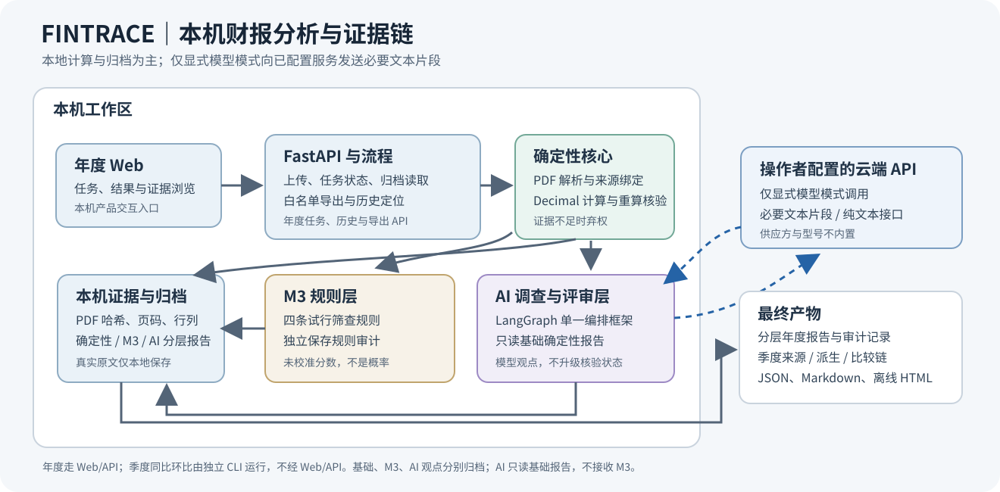

# FINTRACE 决赛技术报告

**面向非金融上市公司财报的可追溯异常线索分析系统**  
项目版本：软件基线 `a24e6a4df46f365be9ef8a9bca03441733c017c6`；年报发现 v2 后端提交 `159d57dced233e434d50f15ad8ef045e06fccc2c`；10/03 冻结快照 `a0b5b3bc26b3004afcd359df48544adb9cba4a13` 保留为历史\
报告日期：2026 年 10 月 5 日

> **结论边界**：FINTRACE 将财务事实、确定性计算、M3 规则与模型观点分层保存，支持年度开放式全文发现和季度样例的可追溯分析。全文发现以本次 PDF 全部可提取文字为扫描目标，在批次、字符和时间预算内按顺序尝试；coverage 说明实际成功、失败、未尝试与截断，不证明模型语义准确或不存在风险。当前证据证明的是特定样例、特定运行和明确的数据范围；不构成对真实舞弊的识别结论，也不证明跨公司泛化。C-01/C-02 真人财务复核、真实季度完整人工复核、真实供应方语义表现、另一台电脑干净安装、现场网络/API 条件和非金融用户理解试验仍须完成或确认。

## 摘要

FINTRACE 面向年报与多期间财务披露中的信息定位、数值复核、变化计算和风险线索整理。它采用本地轻量 Web 与 Python 统计计算；操作者显式选择 AI 年度模式时，系统以本次 PDF 的全部可提取文字为目标，在预算内按顺序分批尝试发送给所配置的模型 API，并在扫描后进行有限输入的最终评审。系统保留来源文档、哈希、页码、行列和口径；财务事实核验器重新打开原文并独立重算，证据不足时弃权。模型观点和 M3 规则筛查处于各自独立审计层，不能修改基础事实核验状态。

软件基线现为 `a24e6a4df46f365be9ef8a9bca03441733c017c6`；年报发现 v2 后端提交为 `159d57dced233e434d50f15ad8ef045e06fccc2c`。完整后端套件 553 项通过、3 项跳过；前端 typecheck/build 通过，未保留独立 stdout 日志。指定 Chrome mock 浏览器检查 57/57 通过，页面 API 请求均由本地拦截，视口为桌面 1366×768 和手机 390×844。对用户创建的 600519/2025 历史运行只读重放了已归档响应：原 v1 的 23 批、6 成功/17 失败和 28 条发现未改写；v2 离线解析得到 15 个完整批次、5 个部分批次、3 个历史超时，104 条输出通过结构/字段/引用校验、5 条被拒绝，9 条仅因 Unicode 空白差异恢复为原文。原 PDF 和报告归档共 58 个文件在重放前后字节一致。本轮没有新发起模型调用；离线重放与浏览器 mock 不证明新版真实供应方表现、超时恢复或线索语义正确。季度命令行切片已在原创模拟材料上完整通过同比与环比计算；在海天真实公开材料上，三项同比有独立依据，三项环比因缺少明确的未追溯调整证据而弃权。三公司评测与受控错误注入说明了独立事实核验的作用，但真人 golden、盲测和舞弊标签指标尚不存在。

最终演示优先使用允许分发的原创模拟样例。真实公开年报仅用于本地开发和评测；再分发许可未确认，不随提交件提供 PDF、整页图或含原文归档。软件基线与本报告、正式证据索引配套维护；源码 ZIP 应从包含这些材料的文档交付 commit/tree 构建。确切 package ID、source commit/tree、ZIP SHA256 和校验结果以包外 manifest、`.sha256` sidecar 与独立验收记录为准。另一台电脑干净安装、现场网络/API 规则、真实供应方、真人复核和非金融用户理解试验仍是独立验收关卡。正式证据与复现边界集中登记在随附证据索引中。



## 1. 问题与目标

财报分析需要同时回答四个问题：数值发生了什么变化，变化由哪些口径一致的原文支持，哪些解释是披露内容或模型观点，下一步还缺什么材料。若只展示抽取值和自然语言总结，金额单位、报告期、合并/母公司口径、比较基数或出处可能无法复核；若将模型自评当成核验，也无法独立发现输入事实错误。

项目把交付目标限定为**财务异常与风险线索的可追溯整理**，不输出舞弊定性或投资建议。第一版优先处理非金融上市公司的文本 PDF 年报，并已增加一个独立季度分析切片。当前系统不含 OCR，不承诺扫描件或任意版式的通用抽取；行业研究、估值、投资判断和任意互联网检索不在已验收功能内。

## 2. 系统架构

React、TypeScript、Vite 提供本机 Web 交互；Python、FastAPI 负责 PDF 处理、财务计算、独立核验和运行归档。LangGraph 是唯一的智能体编排框架，用于显式启用的固定候选调查、全文发现和最终评审流程。财务运算采用 Decimal；模型连接器采用 OpenAI 兼容 Chat Completions 纯文本共有子集，不内置供应方或型号。

年度路径分别包含基础财务核验、独立 M3 规则、固定候选调查、来源 PDF 全文发现和最终评审。全文发现从同一来源 PDF 的所有非空可提取文本块规划批次，没有章节或财务关键词过滤；最终评审只读取基础报告和有界动态发现项，不重新读取全文。季度路径另设累计观察、季度派生、期间比较与 proof 类型，不改写年度 `FinancialFactV2`。产品级报告下载读取经过来源绑定校验的年度归档，再按白名单生成 JSON、Markdown 或离线可打印 HTML；PDF 由用户在浏览器中打印 HTML 产生。

所有新运行、报告、任务状态和评测都写入带唯一 ID 的本机归档。API 与 UI 支持读取任务阶段及历史结果；读取归档属于回放，不等于重新处理。模型凭据只从操作者本机的显式配置加载；报告导出和提交证据不得包含密钥、原始供应方请求/响应或未经许可的 PDF。

## 3. 事实证据链与弃权

每条财务事实保留公司、期间、报告类型、来源文档 ID、原 PDF SHA256、页码、表名、行列、原始金额、币种、单位倍率、报表与合并/母公司口径。页码为 PDF 物理页序号。解析器提供候选定位；独立核验器重新打开相同哈希的原 PDF，重定位行列并重新标准化金额。核验器不把提取器坐标或重复使用同一个提取值当作独立证明。处理顺序是“识别来源与哈希 → 产生候选值 → 原文重定位与重算 → 按明确口径计算 → 绑定来源的归档”；任一环节不成立时，不用下游文字补齐事实。

事实与比较状态为 `verified`、`conflict` 或 `insufficient_evidence`。派生值、可比性和比较结果分别重算并保存依据。未知单位、币种、报告期、范围口径或可比性不能被默认补齐；缺失不等于零。零或负比较基数允许保留有依据的差额，但增长率弃权。当前进程签发的 proof 用于批准对应计算，序列化 proof 只供审计，不能在另一个进程中重建核验授权。

原文引用能定位文本和页图，但引用存在不代表解释成立，更不证明因果。模型说法保留“模型观点”身份；模型自评、引用绑定和最终评审均不替代独立核验。固定候选调查仍采用受限同源检索；独立全文发现则以原 PDF 所有可提取文字为扫描目标，并受明确批次与时间预算约束。集成运行中 M3 分数或状态不进入 AI 输入。

| 层 | 输入与职责 | 故障或缺证时的边界 |
| --- | --- | --- |
| 基础确定性层 | 原始文档、候选事实、独立核验与计算 | 冲突、来源绑定失败或缺证按状态记录；不把不确定值改为零 |
| M3 规则层 | 已核验年度事实；逐条计算并保存规则审计 | 任一规则所需输入不可计算时，不补算总分；不影响基础报告或 AI 层 |
| 固定候选调查 | 标准确定性报告和受限同源候选材料 | 候选可弃权；它不决定全文发现是否启动 |
| 年报全文发现 | 同源 PDF 全部可提取文字的有序批次 | 覆盖/解析/调用失败如实标记；观点未核验，不覆盖事实或 M3 |
| 最终评审 | 基础报告与最多 12 条优先排序的动态发现项 | 只评审实际收到的有限上下文；评审失败不抹掉已保存发现 |

## 4. 年度模式与规则筛查

年度流程提供四种模式，调用范围如下。

| 模式 | 调用与产物 | 解释边界 |
| --- | --- | --- |
| `deterministic` | 本地解析、事实核验、年度计算、Claim 核验和报告归档 | 不调用模型；单样例通过不代表通用抽取 |
| `m3_screening` | 基础年度报告及四条 M3 规则审计 | 不调用模型；规则分数不是概率或舞弊判断 |
| `model_investigation` | 固定候选调查、同源 PDF 全文发现和最终评审 | 显式模型配置；全文发现以全部可提取文字为目标，最终评审仅读取基础报告和有限发现项 |
| `integrated_analysis` | 同一任务内保留基础报告、独立 M3 层及完整 AI 层 | M3 与 AI 分开；任一附加层有问题时其他层尽量保留 |

### 4.1 年报全文发现的范围和状态

全文发现独立于两条固定候选线索、`confirmed_metrics` 和 M3。解析器将本次来源 PDF 的全部非空可提取文本块按页和原顺序纳入规划，不用现金流词、章节标题或公司模板筛选。较长文本块切成不超过 1200 字符的片段。单批正文上限 12,000 字符，实际序列化请求上限 24,000 字符；全文最多规划 128 批、1,200,000 字符，发现引擎总墙钟预算 1,800 秒。文本总量超过规划上限时，coverage 明示尾部遗漏；单批失败后继续后续批次，失败页也作为未完整处理范围记录。

v2 提示词每批最多提出 3 条值得核查的线索；解析器保留最多 6 条的安全上限以兼容历史响应。程序仍严格检查响应容器，并逐条校验发现的字段、长度、优先级及原文引用；无效项单独拒绝，同一批中其余通过检查的项仍保留，因此一个批次可为 `partial`。相同片段 ID 可对应多条不同的精确连续引用；同一 `(evidence_id, quote)` 重复仍拒绝。引用若仅有 Unicode 空白排版差异，且在指定片段中去空白后恰有一个匹配，程序可恢复为不超过 300 字符的连续原文，并计入 `restored_quotes`。这些检查建立的是结构和引用绑定，不是观点的独立语义核验。

`completed` 要求至少有可提取文字，且原 PDF 的全部可提取文字均由完整成功批次处理；不得有部分/失败批次、未尝试文字、超限截断或未读图片页。`partial` 保留通过逐条校验的发现并标出未完整处理范围。部分批次的字符不计入 `processed_chars`，相关页仍列为未完整处理；全部已尝试批次失败且没有可用发现时为 `failed`；未发起调用为 `not_called`。历史 v1 归档继续按原严格规则读取，不应用 v2 引用恢复。扫描件和图片不执行 OCR，无文字页或图像文字不属于可提取文字覆盖。最终评审最多接收 12 条优先发现，实际序列化请求体不超过 16,000 字符；未送入评审的发现仍保留在报告中。Web job 启动的 CLI 子进程默认和最大时限均为 3,600 秒；独立 CLI 无该 job 外部时限。批次进度只说明批次处理阶段结束，不代表最终评审或归档完成；若进程在正式报告归档前被硬中断，不能保证存在可回读的完整报告。

AI 观点固定标为“未经独立语义核验”；priority 表示核查顺序而不是概率。引用页图仅显示被引片段，bbox 高亮块范围，不保证完整段落或精确字符。空 findings 是合法结果，基础年度比较与动态发现可以重合；不保证不同 PDF 得到不同标题。默认仍使用不调用模型的本地确定性模式。若后端 capability 缺少或返回 `false` 的 `annual_discovery_supported`，前端禁用新版全文 AI 提交；操作者加载新版后端需重启服务，旧 AI 归档则按实际层字段显示，不从旧 mode 推断全文扫描。

M3 的四条试行规则分别观察利润与经营现金流方向差异、归母净利润与扣非归母净利润差距、应收账款增速相对收入增速偏离、存货增速相对营业成本增速偏离。每条触发计 25 分；任何规则不可计算时总分缺失，不按部分结果补零。阈值未经过隔离评测校准，第二条版式映射仅对海天样例建立。

海天味业 603288 / 2024 年报的已接受集成 Web 运行中，四条规则均可计算且没有触发，显示 0/100。调查一条候选因结构或同源引用约束弃权，另一条留下未核实解释；最终评审保留“原因未确认”。该次模型名 `deepseek-flash` 是运行审计中的实际记录，不是应用默认型号。三次请求成功只证明该次连通与流程完成，不证明解释因果正确或其他公司适用。

## 5. 季度计算方法

季度切片只处理营业收入、归母净利润和经营活动产生的现金流量净额三类流量指标。季度值由相邻累计数推导：

| 目标期间 | 派生公式 |
| --- | --- |
| Q1 | 一季度累计值 |
| Q2 | 半年累计值 − 一季度累计值 |
| Q3 | 前三季度累计值 − 半年累计值 |
| Q4 | 全年累计值 − 前三季度累计值 |

资产负债表时点值不做差分。同比比较同一公司、同一指标的上一年同季度；环比比较相邻季度，跨年 Q1 对比上一年 Q4。每个来源累计数、派生季度值与最终比较结果都分别核验。可比性要求公司、指标、期间、币种、单位倍率、报表和口径一致；跨报告环比还需要针对相关值的未追溯调整/更正证据。仅仅没有发现调整字样不构成未调整证明。

设本期值为 `x`、比较值为 `y`。只有两个输入均独立核验通过且可比性成立，才计算差额 `Δ = x − y`。在此基础上，若 `y > 0`，增长率为 `g = Δ / y`；若 `y ≤ 0`，保留差额并弃权增长率。若任一输入未核验通过，或比较关系的口径/追溯依据不足，则差额和增长率都弃权。来源、派生和比较 proof 绑定源 PDF 哈希与目标内容摘要；读取 JSON 不会取得新的 proof 授权。

## 6. 原创季度案例与真实材料边界

### 6.1 原创模拟完整案例

季度样例 `SIM-QUARTERLY-001` 是团队人工构造数据，不代表任何真实公司。2024 年 Q2 由 2024 H1 累计数减 Q1 累计数得到；下面将其与 2023 Q2 作同比、与 2024 Q1 作环比。金额单位均为元，合并口径。运行从四份有版本化清单的模拟 PDF 读取累计观察，所有数据都标为 CNY / 元 / 合并报表。

| 指标 | 2024 Q1 累计 | 2024 H1 累计 | Q2 派生（H1 − Q1） |
| --- | ---: | ---: | ---: |
| 营业收入 | 1,200,000 | 2,700,000 | 1,500,000 |
| 归母净利润 | 120,000 | 300,000 | 180,000 |
| 经营活动现金流量净额 | −20,000 | 120,000 | 140,000 |

以营业收入为例，解析器从 H1 报告取得 2,700,000 元、从 Q1 报告取得 1,200,000 元。核验器分别检查文档 SHA256、报告身份、合并利润表、营业收入行、期间列、单位和币种，再独立重算 `2,700,000 − 1,200,000 = 1,500,000`。季度派生 proof 绑定两份源 PDF 哈希及目标摘要；它只能说明该输入组合下的计算受支持，不能被复制的 JSON 当作可迁移授权。

| 指标 | 2023 Q2 | 2024 Q1 | 2024 Q2 | Q2 同比 | Q2 环比 |
| --- | ---: | ---: | ---: | ---: | ---: |
| 营业收入 | 1,400,000 | 1,200,000 | 1,500,000 | +100,000（+7.14%） | +300,000（+25.00%） |
| 归母净利润 | 160,000 | 120,000 | 180,000 | +20,000（+12.50%） | +60,000（+50.00%） |
| 经营活动现金流量净额 | 100,000 | −20,000 | 140,000 | +40,000（+40.00%） | +160,000（增长率弃权） |

2024 Q2 原始值按 H1 累计减 Q1 累计派生。经营现金流的 2024 Q1 环比基数为 −20,000 元，差额为 +160,000 元；负基数不计算百分比增长率。该次模拟运行共核验 24 个来源观察、9 个派生季度和 6 个比较，均为 `verified`；`quarterly-analysis-6e7807fc-f25c-4dbc-bf80-5323fc902296` 状态为 `completed`。这是完整可复现的算法样例，不是真实公司表现或舞弊标签。

### 6.2 海天真实公开报告运行

真实材料取自海天味业 2023 年 Q1、2023 年 H1、2024 年 Q1 与 2024 年 H1 报告，只用于本地开发/评测；原文再分发许可未确认。运行 `quarterly-analysis-8118d2c1-aa50-4c2f-a6c2-7775b0557253` 对 2024 Q2 建立 24 个来源观察、9 个季度派生和 6 个比较。所有来源观察和派生季度均独立核验通过。三项同比关系通过；三项环比因来源中未发现针对各指标的明确未追溯调整/更正证据而 `insufficient_evidence`，未输出环比差额或增长率。下表金额单位为人民币元，均为合并口径。

| 指标 | 2023 Q2 | 2024 Q2 | 同比差额 / 增长率 | 环比状态 |
| --- | ---: | ---: | ---: | --- |
| 营业收入 | 5,984,561,741.10 | 6,462,059,791.79 | +477,498,050.69 / +7.98% | 证据不足，弃权 |
| 归母净利润 | 1,380,650,003.76 | 1,534,169,965.45 | +153,519,961.69 / +11.12% | 证据不足，弃权 |
| 经营活动现金流量净额 | 1,523,960,895.91 | 1,681,204,524.60 | +157,243,628.69 / +10.32% | 证据不足，弃权 |

该真实运行的同比依据包括当年报告中的上年同期比较列及核验器对来源值的重定位；它仅覆盖一个公司、一个期间和三项指标。环比弃权展示了系统在比较证据不足时的行为，不应以模拟数据的环比通过替代真实环比验收。原始真实 PDF、含原文归档和整页图片均不纳入公开提交件。

## 7. 多公司评测与受控错误实验

C-01 运行涉及海天味业、贵州茅台和五粮液的三份 2024 年年报，共 24 条事实参考，每家公司 8 条。海天作为适配参考；茅台与五粮液虽然按公司隔离处理，但已存在历史运行和临时参考转录，因此不是盲测。16 条事实通过独立核验（海天 8、茅台 8），0 条冲突；五粮液 8 条因币种证据不足而弃权。上述记录仍为 `agent_provisional_pending_human`，未成为人工 golden。

在 15 条人工注入的金额、期间、口径等受控错误中，schema-only 基线接受 15 条；独立核验接受 0 条、以 `conflict` 拒绝 11 条、以 `insufficient_evidence` 弃权 4 条。弃权不计作正确拒绝。这说明设计的独立核验步骤能拦截这组构造错误；它不能估计生产环境错误率或真实舞弊识别率。

| 受控错误集合（15 条） | Schema-only 接受 | 独立核验 `verified` | `conflict` | `insufficient_evidence` |
| --- | ---: | ---: | ---: | ---: |
| 人工注入金额、期间、口径等错误 | 15 | 0 | 11 | 4 |

这里的 11 条冲突是有原文反证的拒绝；另 4 条是缺少充分依据时的弃权。它们不能合并成单一“准确率”，也不能代表自然发生错误中的召回率。

旧 M4 单公司协议保留两个由 agent 转录且未经真人复核的 clean 值，以及五个注入错误案例。没有可用于计算真实舞弊准确率、误报率或漏报率的人工标签，舞弊指标分母为零。三公司人审包的 24 条复核字段仍为 pending；复核人、日期、结论与依据均未填写。外部处罚信息和人工答案不会进入分析输入。

## 8. 样例、导出与数据条件

最终交付优先包含两组原创模拟样例：年度样例 `SIM-ANNUAL-001`（澄湾云算股份有限公司，虚构）与季度样例 `SIM-QUARTERLY-001`（示例食味有限公司，虚构）。其 manifest 登记 SHA256、公司/期间、生成工具和允许用途。年度 PDF 当前 SHA256 为 `f193e7a497fe483d3ab70b7bde2880f715ff1127b1d8b14cc3f4fda678ba0bf7`；季度样例含四份 PDF，并在 `data/samples/quarterly/source_manifest.json` 中逐份登记哈希。样例可随比赛提交件及团队演示包分发，需保留“原创模拟”标识和使用条件；不得当作真实财报、投资依据、舞弊/违规标签或模型训练标签。

海天、茅台、五粮液真实年报和海天季度材料目前只登记为本地开发/评测资料。公开可读不自动授予再分发许可。现场公开演示使用原创样例；需要真实材料复核时，应由团队按官方来源自行取得、比对哈希并遵守适用许可。

年度归档导出接口为 `GET /v1/annual-analyses/{run_id}/export?format=json|markdown|html`，只读取既有 run，不重新分析或触发模型。

| 格式 | 输出用途 | 来源和字段边界 |
| --- | --- | --- |
| JSON | 可审计的年度结构化报告 | 验证固定目录、manifest、run 与报告身份、来源文档和 PDF SHA 后，对嵌套字段按白名单投影 |
| Markdown | 可编辑、可检索的文本报告 | 以纯文本安全呈现归档内容；链接和格式字段不会改变核验状态 |
| 离线 HTML | 浏览、打印与留存 | 转义正文，仅内嵌样式，不加载脚本或外网资源；用户可用浏览器打印成 PDF |

任何格式均不带整份 PDF、整页图、原始模型请求/响应、密钥或任意扩展字段。既有叙述层仍按原有规则投影受控 `raw_text` 片段；新增全文发现层导出动态观点、覆盖、限制和来源定位，但不含其 `raw_text` 或模型 `quote`。年度可比性只有在文档 ID、PDF 哈希与报告年度均完整匹配当前归档时才连同证据输出；绑定不完整会降为“来源未验证”，绑定不符会标记“来源错配”，两者均不带可比性证据。M3、调查、全文发现和最终评审层均检查归档来源绑定；新发现 SHA、引用或结构异常时读取、索引、页图与导出 fail closed。声明了顶层最终评审时，嵌套评审不能绕过顶层身份检查。导出只呈现归档状态，不提升证据等级。年度 JSON、Markdown、离线 HTML 的 API/UI 下载、旧归档模式和来源降级规则专项验收，以及浏览器离线打印版面检查均已主控接受；新增 UI 原创样例运行与下载验证见[正式证据索引](evidence/README.md)。PDF 由浏览器打印生成，服务端没有 PDF 导出端点。

## 9. 复现与现场演示流程

推荐流程是先展示来源性质清楚的原创年度样例，再运行原创季度 Q2 同比/环比案例，最后用真实季度运行说明证据不足时如何弃权。UI、报告和口头讲解应把“模拟演示”“真实本地评测”“历史归档回放”分别标明。报告引用证据目录中的结构化导出与运行摘要，不展示许可未确认的原文页图。

在源码目录按根 README 准备 Python、Node 和项目依赖；开发启动脚本不会自行安装依赖，也不读取模型凭据。原创年度样例可用如下确定性 CLI 命令重跑，不请求云模型：

```powershell
python scripts/analyze_annual.py --source-pdf data/samples/annual/sim-annual-001-2025.pdf --company-id SIM-ANNUAL-001 --report-year 2025 --document-id sim-annual-001-2025 --expected-sha256 f193e7a497fe483d3ab70b7bde2880f715ff1127b1d8b14cc3f4fda678ba0bf7
```

季度原创样例的 2024 Q2 同比/环比演示命令为：

```powershell
python scripts/analyze_quarterly.py --year 2024 --quarter Q2
```

两种 CLI 都产生唯一 run ID；年度运行输出进入 `artifacts/runs/<run_id>/` 与 `artifacts/reports/<run_id>/`，季度输出分别为 `analysis.json` 和 `quarterly-analysis.md`。默认演示仍选择 `deterministic` 或 `m3_screening`，展示新 run ID、来源哈希、核验状态和报告。只有在确认组委会网络/API 规则并获得授权后，操作者才显式配置模型并选择“AI全文发现与评审”模式；该模式以所选 PDF 的全部可提取文字为目标，在预算内按顺序分批尝试发送给配置服务，单批失败后仍尝试后续批次，费用和等待随文本量增加。接口“测试连接”会产生真实供应方请求，不用作离线检查。本轮构造 PDF 的 CLI/API 集成检查使用本地 mock connector；另对既有真实响应归档做了只读离线重放，本轮没有发起新的 provider 调用。两类检查均不构成新版供应方实测。Windows x64 / CPython 3.14.3 runtime 锁供对应环境使用，不是跨平台通用锁；源码包不包含 Python、Node 或已安装依赖。软件基线、正式年度/季度证据、代码指纹和已验证环境以 [`evidence/README.md`](evidence/README.md) 及其链接的审计记录为准。

年报结果页改为紧凑线索列表，提供搜索与优先级筛选，扫描明细和原文引用默认折叠。操作者显式选择“重新分析这份报告”后，系统会沿用原模式和来源创建新 job，并重新处理整份报告；只有 AI 模式会按预算再次发送可提取文字，可能产生模型调用和费用，deterministic 与 M3 模式不调用模型。重分析不是仅补跑失败批次，旧报告仍保留。此 UI 流程由本地 mock 浏览器检查覆盖，不代表真实模型超时后的恢复已验证。

`scripts/start.ps1` 会探测并复用已识别的本项目 8000 API；其 Uvicorn 进程没有 `--reload`。检查新后端代码是否生效时，不能只刷新浏览器、关闭启动 CMD 或再次运行 `start.bat`。应先确认当前监听 8000 端口的 PID 确实属于本源码目录，再按[运行与交付验收指南](运行与交付验收指南.md)停止该 API PID，并运行 `start.ps1 -NoBrowser`；脚本可继续复用 5173 上的 Vite。前端文件可由 Vite 热更新。文档装配没有操作或验证默认 8000/5173 服务是否已重启。

显式启用模型流程前，应先由现场负责人确认组委会对网络、供应方和 API 的要求，再由操作者配置本机环境。配置测试会实际发送供应方请求，不应作为离线检查。若网络、模型、LangGraph 或新版全文发现能力不可用，可用 deterministic 或 M3-only 流程现场处理原创样例，并明确说明 AI 层未运行；旧服务器缺少 `annual_discovery_supported` 时不可把旧候选调查称为全文扫描，需要部署并重启含新版代码的后端。若读取历史结果，界面必须标为回放，不称为实时处理。

### 常见失败与恢复

- 扫描版、加密或损坏 PDF：当前没有 OCR，停止并换用允许的文本型材料；不要把空抽取当作零值。
- 公司、期间、单位、币种或合并口径不清：检查来源身份与原文披露；不能确认时保留弃权状态。
- 季度累计值有冲突、追溯状态不明或跨期口径变化：查看各来源观察与证据；修正输入材料后用新 run 重跑，不手工改归档。
- 模型调用失败或输出不满足引用/结构约束：保留基础报告与其他成功层，展示模型层问题；不要把模型意见补写成确定事实。
- 服务重启或任务中断：按 job/run ID读取归档状态；历史回放与重算分别标注，不重复触发可能产生新调用的任务。

## 10. 当前验收缺口

截至 2026 年 10 月 5 日，仍有以下验收关卡待完成或待外部确认：

| 关卡 | 当前证据 | 尚未完成的确认 |
| --- | --- | --- |
| C-01 多公司人工评测 | 24 条待审事实包；15 条受控错误注入 | 真人复核人、复核结论、盲测和可靠性统计 |
| C-02 季度分析 | 模拟同比/环比全链通过；真实海天三项同比通过 | 真实材料的三项环比可比性证据与完整人工复核 |
| C-03 最终源码与演练 | 当前接受的软件基线 `a24e6a4df46f365be9ef8a9bca03441733c017c6`，后端发现 v2 提交 `159d57dced233e434d50f15ad8ef045e06fccc2c`；10/03 冻结检查、原报告和 `90582a9` 源码包均保留其历史绑定。本报告与正式证据索引配套当前接受基线 | 每个源码包准确的 package ID、source commit/tree、ZIP SHA256 与校验结果以包外 manifest、sidecar 和独立验收记录为准；另一台 Windows 电脑干净依赖安装、现场实时运行、组委会网络/API 条件仍待确认。非金融用户 30 秒理解试验单列为用户验收 |
| C-04 年报开放式全文发现 | 用户创建的茅台 2025 历史运行完成只读离线响应重放：23 批中 15 个完整、5 个部分、3 个既有超时；104 条模型输出通过结构/字段/引用校验，5 条拒绝，9 条引用仅因 Unicode 空白差异恢复。原始 58 个归档文件在重放前后哈希一致。Chrome 中 57/57 个本地 mock 检查通过，UI 类型检查和构建通过 | 这些结果没有发起新版真实 provider 调用，不证明实时质量、耗时或超时恢复；跨公司语义人审、非金融用户理解试验以及扫描件/图片文字（当前无 OCR）仍待验收 |
| 产品易用性 | 浏览器中的既有年度流程已按矩阵检查 | 非金融用户 30 秒理解试验 |
| 竞赛材料 | 技术报告由本项目维护 | 计划书最终 PDF、视频 MP4、平台上传由各自材料负责人完成 |

这些缺口影响的是相应验收范围，不能由单次模型调用、模拟数据全通过或本机源码包校验替代。报告与正式证据索引配套当前接受的软件基线；每个源码包的准确绑定及校验结果以 ZIP 同目录包外 manifest、`.sha256` sidecar 和独立验收记录为准。报告不在自身内部嵌入最终文档提交号或自身 SHA256。

## 11. 结语

FINTRACE 当前软件基线为 `a24e6a4df46f365be9ef8a9bca03441733c017c6`，形成了本机财报分析原型、可追溯年度核验与导出、独立 M3 规则、年报开放式全文发现与评审、季度同比环比计算切片、原创演示材料和多公司受控错误实验。系统能展示数值来源、重算依据与证据缺口，并在可比性不足时弃权；年报发现 v2 可逐条校验模型输出、保留通过检查的发现并如实标记部分覆盖，但观点仍未经独立语义核验。C-01/C-02 真人财务复核、真实季度环比证据、新版真实供应方表现与超时恢复、跨公司语义人审、另一台电脑运行演练、现场规则核对及非金融用户理解试验仍待各自完成；这些未完成事项不改变已验收的离线重放和 mock 页面范围。最终源码 ZIP 的准确绑定与校验读取包外 manifest、`.sha256` sidecar 和独立验收记录。

## 参考资料

竞赛要求依据：《2026 年北京市大学生金融人工智能竞赛通知》，北京市教育委员会，2026-08-26，项目原始资料 `比赛通知.txt`。

项目架构、数据边界、交付路线和验证记录：[`docs/architecture.md`](../../docs/architecture.md)、[`docs/data-policy.md`](../../docs/data-policy.md)、[`docs/roadmap.md`](../../docs/roadmap.md)、[`docs/product-delivery-roadmap.md`](../../docs/product-delivery-roadmap.md)、[`docs/verification-history.md`](../../docs/verification-history.md)。年度导出边界、季度实现与多公司评测协议：[`docs/annual-report-export.md`](../../docs/annual-report-export.md)、[`docs/quarterly-analysis.md`](../../docs/quarterly-analysis.md)、[`evaluation/README.md`](../../evaluation/README.md)、[`docs/multicompany-evaluation.md`](../../docs/multicompany-evaluation.md)。

原创样例使用条件：[`docs/annual-samples.md`](../../docs/annual-samples.md) 及年度、季度 `source_manifest.json`。字体来源、fsType、SHA256 与排版工具版本见 [`docs/dependencies.md`](../../docs/dependencies.md)；官方依据为 [Microsoft YaHei](https://learn.microsoft.com/en-us/typography/font-list/microsoft-yahei)、[OpenType `OS/2.fsType`](https://learn.microsoft.com/en-us/typography/opentype/spec/os2) 与[字体嵌入 FAQ](https://learn.microsoft.com/en-us/typography/fonts/font-faq)。PDF 嵌入系统字体子集，不随报告分发字体文件。
